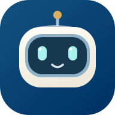
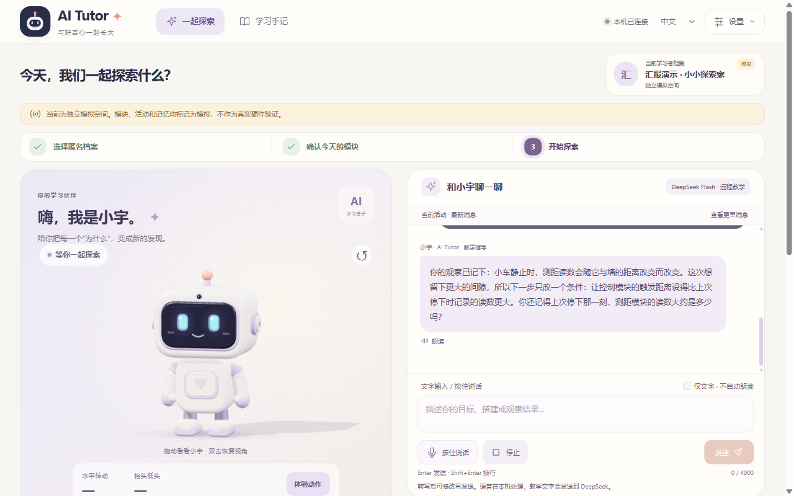
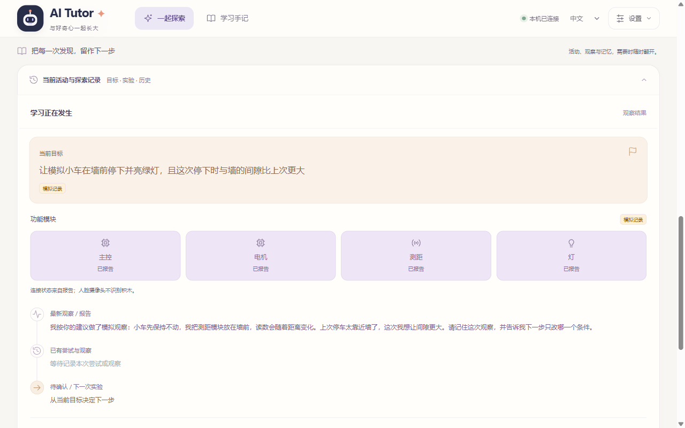
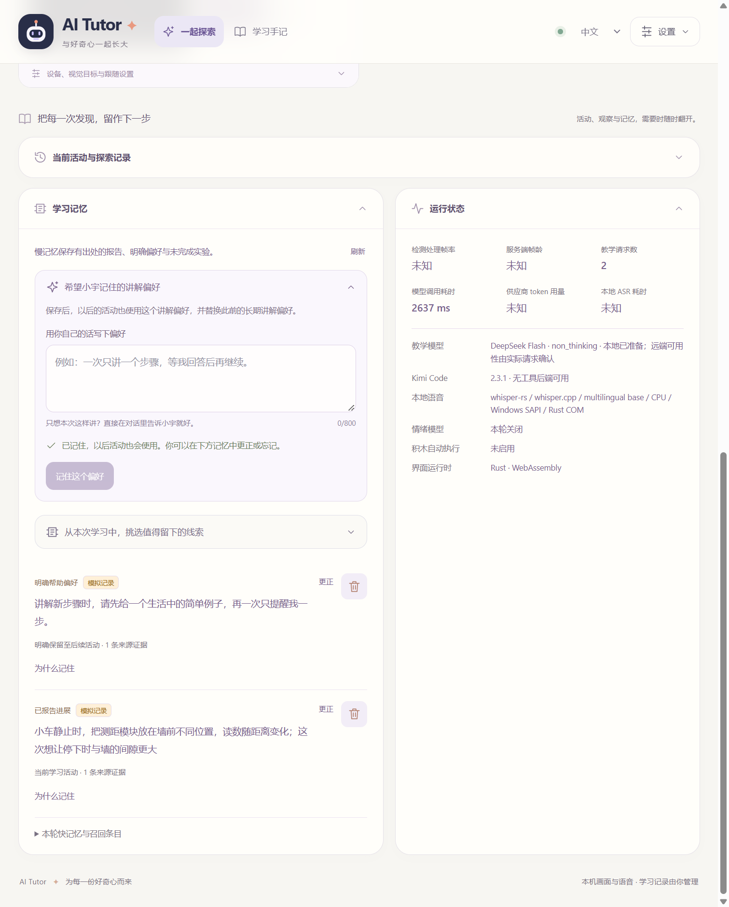
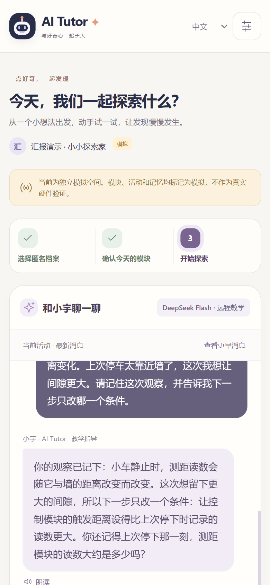
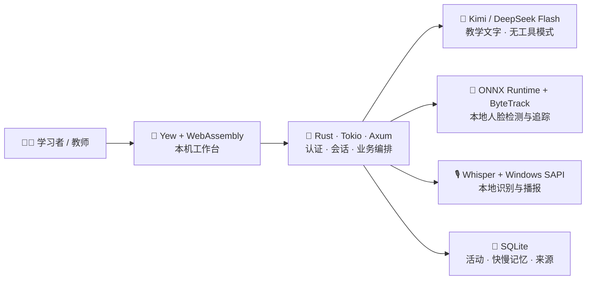

<div align="center">



# AI Tutor 🤖🌱

### 你的桌面建造学习伙伴

**把「我想试试」，慢慢变成「我做到了」。**

一个会倾听、会追问、记得进步，也尊重遗忘的本机 AI 工作台。

[](#-从这里出发)
[](#-可爱外表下的硬核内核)
[](#-技术拼图)
[](LICENSE)

[认识小伙伴](#-让学习成为一场小小的探险) · [产品亮点](#-你会喜欢它的六个理由) · [快速开始](#-从这里出发) · [隐私安全](#%EF%B8%8F-你的学习小世界由你守护) · [参与贡献](#-一起把它变得更可爱)

</div>

---

## 🌈 让学习成为一场小小的探险

有时候，学习者需要的不是一个立刻报出答案的「标准答案机」，而是一个愿意陪自己把想法说清楚的小伙伴：

- **「我想做一辆会避开墙的小车！」** —— 先一起说说目标和手里的模块。
- **「它刚才停得太近了。」** —— 把观察留下来，下一次只改变一个条件。
- **「上次我们做到哪里了？」** —— 有来源的进步会被记住，新的开始也不会误用旧接线。
- **「这条不对，请忘掉吧。」** —— 记忆可以纠正，也可以真正删除。

AI Tutor 围绕**主控、电机、测距和灯**等实体功能模块，陪伴学习者经历：

<div align="center">

**说出目标 💭 → 确认模块 🧱 → 动手试验 🔧 → 描述观察 👀 → 修改想法 ✨ → 保存进步 🌱**

</div>

> [!IMPORTANT]
> AI Tutor 当前是 **Windows 本机教学原型**：它帮助学习者描述、搭建、试验和复盘，**不控制实体小车、不识别积木拓扑，也不进行人脸身份或情绪判断**。可爱可以天马行空，能力边界必须清清楚楚。💛

## 📸 看看小宇认真工作的样子

下面不是概念图，而是优化后工作台在真实浏览器中的运行画面：匿名模拟档案、四个模拟模块、两轮真实 DeepSeek Flash 教学，以及有来源的学习记忆。



> 🎤 **明天要汇报？** 直接打开 [10 分钟完整汇报指南](docs/PRESENTATION_GUIDE_20261126.md)：包含逐分钟流程、讲稿要点、现场输入、真实回复、5 分钟压缩版，以及断网、无摄像头和无麦克风备用方案。

### 🧠 不只聊一次，还把学习过程留下来

| 真实活动与模拟观察 | 两条有来源的记忆与运行状态 |
|---|---|
|  |  |

学习者可以看到当前目标、模块来源和最新观察；学习进展与明确偏好都能检查来源、更正或遗忘。界面也会诚实显示：**情绪模型关闭，不根据人脸推断情绪。**

### 📱 手机也能舒服地继续探索

<div align="center">

</div>

小高度桌面窗口优先保留输入、语音、停止和发送按钮；手机端先显示对话，再展示机器人与辅助面板。三步准备引导、快捷键提示和字数计数，让第一次使用也知道下一步。

### 👀 检测人脸，但不识别「你是谁」

<div align="center">

</div>

这张图片来自 [Michael Dam / Unsplash](https://unsplash.com/photos/mEZ3PoFGs_k)（Unsplash License）。项目固定的 ONNX 模型在本机完成真实推理，检测到 **1 张人脸，置信度约 0.906**；标注框来自模型输出。它只证明**离线人脸检测**，不证明身份识别，也不因为人物微笑就生成情绪标签。原图不发送给远程教学服务。

## 🎀 你会喜欢它的六个理由

### 🧠 1. 记得你的进步，也听得进「不对」

快记忆承接当前活动，慢记忆保留有来源的进展。每条长期记忆都能查看来源、纠正或删除；遗忘还会清理相关派生记忆和暂态上下文，避免旧内容悄悄「复活」。

### 🎙️ 2. 把想法说出来，不急着发送

按住说话，松开转写。Whisper 在本机完成识别，你可以检查、修改，再决定是否发送；教学回复使用 Windows 本地声音朗读，随时可以停止。

### 👀 3. 看见互动对象，但不给人贴标签

需要视觉互动时，可以开启摄像头并点击人脸框，选择临时视觉目标。它不会根据画面猜测身份、年龄或情绪，也不会因为换了一张脸就偷偷更换学习档案。

### 🧱 4. 不代替动手，只帮你把下一步想清楚

模块清单来自学习者报告、教师确认或独立模拟，不会把一句「我接好了」冒充成硬件验证。AI 可以提出下一步建议，但真正搭建、试验和观察的主角始终是学习者。

### 🗂️ 5. 每个人，都有自己的小世界

匿名档案彼此隔离，真实记录与模拟空间分别保存。重新开始活动时会召回历史进展，却仍要重新确认当前搭建——记得过去，不把过去当成现在。

### 🛡️ 6. 本机优先，少一点数据远游

服务只监听 `127.0.0.1`，页面、视频与 WebSocket 都有本机认证和来源检查。摄像头画面、录音与本地识别不发送到远程模型；默认不保存原始视频、人脸裁剪或原始录音。

## 🚀 一段学习旅程，可以这样开始

> 🧒 **学习者：**「我想让小车在墙前停下来，然后亮一盏灯。」
>
> 🤖 **AI Tutor：**「我们先确认一下：现在有主控、电机、测距和灯吗？你准备怎样知道它已经停稳了？」
>
> 🧒 **学习者：**「它停了，可是离墙太近。」
>
> 🤖 **AI Tutor：**「这次先只调整停车的判断条件，其他设置保持不变。你想把间隙调大一点吗？试完告诉我你看到了什么。」

*以上为交互示意，实际回复由模型根据当前档案、已确认模块、观察报告与有效上下文生成。*

没有「一键替你做完」的魔法，只有一次次小小的尝试，和一句认真的：**「我们再试一次吧。」** ✨

## 🧩 真实记录与模拟空间，各住各的小房间

| 空间 | 适合做什么 | 数据与边界 |
|---|---|---|
| 🧑‍🏫 **真实档案** | 记录真实学习者的目标、人工确认的模块、试验观察与进步 | 只接受学习者报告或教师确认；不会执行电机动作，也不会把报告升级为硬件验证 |
| 🧪 **模拟档案** | 演练教学流程、测试多轮对话、体验记忆纠正与遗忘 | 使用独立 SQLite 数据库；模拟事件不能写入真实档案，模拟结果不代表实体设备已运行 |

## 🛠️ 从这里出发

### 出发前，准备这些小道具

| 准备项 | 说明 |
|---|---|
| 💻 **Windows x64** | 当前应用面向 Windows 本机运行 |
| 🦀 **Rust 与构建工具** | 已验证环境为 Rust 1.98.1、MSVC 与 Windows SDK；新机器需检查 [`.cargo/config.toml`](.cargo/config.toml) 中的本机工具路径 |
| 🌙 **Kimi Code CLI 2.3.1** | 默认使用官方 CLI 的正常登录作为教学模型后端；教学文字会产生远程模型请求及相应用量 |
| ⚡ **DeepSeek Flash（可选）** | 复现本页两轮演示时使用；密钥通过项目脚本加密保存在仓库之外 |
| 🎙️ **麦克风与摄像头（可选）** | 文字教学可独立使用；语音需要麦克风，视觉互动需要摄像头 |
| 📷 **OBSBOT Tiny3（可选）** | 已有真实设备发现与视频链路证据；普通文字和语音流程不依赖它 |

运行安装好的应用**不需要 Python、Node、npm 或前端开发服务器**。安装与构建阶段使用 Windows PowerShell、Rust 和本机编译工具。

### 1️⃣ 把小伙伴带回家

```bash
git clone https://github.com/heeh02/AI-Tutor.git
cd AI-Tutor
```

### 2️⃣ 安装并构建

确认 Rust、Windows C++ 生成工具及 Kimi Code CLI 已准备好，然后双击 **`Install AI Tutor.cmd`**，或在项目根目录运行：

```powershell
powershell -NoProfile -ExecutionPolicy Bypass -File scripts/install-rust.ps1
```

安装脚本会：

- 按清单下载并校验人脸检测模型、Whisper base 模型与原生依赖；
- 构建 Rust 本机程序和 Rust/Yew WebAssembly 界面；
- 将程序安装到 `bin/`，界面资源安装到 `frontend/dist/`；
- 更新已有安装时先暂存与校验，再正常停止旧服务，失败时恢复已替换文件；
- 最后核验真实 Kimi 无工具连接，不提取 OAuth 令牌，也不改写全局 Kimi 配置。

> [!NOTE]
> 源码仓库不附带模型权重、编译产物和 `bin/*.exe`，首次克隆后需要先运行安装脚本。模型来源、版本、许可证信息与 SHA-256 摘要保存在 [`models/`](models/) 的清单中。

### 可选：使用 DeepSeek Flash 教学

默认教学后端是 Kimi。需要复现本页演示时，也可以显式选择 DeepSeek Flash：

1. 在 PowerShell 运行 `scripts/validation/store-deepseek-secret.ps1`，按隐藏提示输入密钥。密钥使用 Windows 当前用户 DPAPI 加密，保存在仓库之外；脚本不会覆盖已有凭证。
2. 创建 `runtime/teaching-provider-policy.json`：

   ```json
   {
     "protocol_version": 1,
     "provider": "deepseek_flash",
     "thinking": "non_thinking"
   }
   ```

3. 重新启动工作台，确认页面显示「DeepSeek Flash · 远程教学」。配置只在启动时读取，本地预检通过不代表远端一定可用，仍以实际请求结果为准。

**密钥不要写入该 JSON、源码、截图或 Git 提交。** 教学文字会发送到 DeepSeek；画面和录音仍留在本机。

### 3️⃣ 打开学习工作台

双击 **`Start AI Tutor.cmd`**，应用会打开经过本机认证的工作台：

```text
http://127.0.0.1:8765/
```

然后创建或选择匿名档案，说出第一个目标就好。需要视觉互动时再开启摄像头；只使用文字或语音也完全可以。

如果页面提示需要启动凭证，请再次使用启动器。**临时认证链接不要转发给别人。** 🔐

### 4️⃣ 今天的探险结束啦

点击工作台的「结束并保存」，保留有来源的进展；双击 **`Stop AI Tutor.cmd`** 停止本机服务并释放设备。只关闭浏览器并不会停止后台服务。

## 🎮 工作台小指南

| 操作 | 它会发生什么 |
|---|---|
| 🎯 **输入目标或观察** | 模型只根据有效上下文生成教学回复；建议不会自动变成「已经完成」 |
| 🎤 **按住说话，松开转写** | 本地识别后先展示文字，检查或修改后再发送，不会松手就自动提交 |
| 🔊 **播放或停止回复** | 只朗读当前有效且已显示的教学回复；新输入与停止操作会使旧播报失效 |
| 🧠 **展开学习记忆** | 查看来源、纠正事实或删除记忆；真实档案之间互不影响 |
| 💾 **结束并保存** | 先保存观察，再保留有来源的进展；下次可召回历史，但当前模块仍需重新确认 |
| 👁️ **选择临时视觉目标** | 只改变当前视觉互动对象，不切换档案，也不自动启用物理云台 |

面向辅助工具与自动化检查，项目还提供 `bin/tutorctl.exe`。它通过本机认证 API 读取状态和控制工作台，不直接读取数据库，也不绕过界面确认。完整入口见 [CLI 使用说明](docs/CLI.md)。

## 🛡️ 你的学习小世界，由你守护

| 数据 | 去哪里 | 默认保存方式 |
|---|---|---|
| 💬 **教学文字与必要匿名上下文** | 发送到当前选择的远程教学服务（Kimi 或 DeepSeek），用于生成教学回复 | 应用本地记录学习活动；远程服务规则由对应服务决定 |
| 📷 **摄像头画面与人脸框** | 仅在本机处理 | 默认不保存视频或人脸裁剪 |
| 🎙️ **麦克风录音** | 仅在本机交给 Whisper 识别 | 默认不保存原始录音 |
| 🗣️ **语音播报** | 本机 Windows SAPI | 不依赖远程语音合成 |
| 🌱 **档案、活动与记忆** | 本机 `runtime/data/` | 真实与模拟分别存入 SQLite，不自动备份 |
| 🔑 **启动凭证** | 仅用于本机页面引导与认证 | 使用随机 HttpOnly、SameSite 严格 Cookie；诊断不记录认证链接 |

此外，API、视频与 WebSocket 均执行 Host / Origin 等来源检查，不提供公共部署入口。无实际令牌用量数据时，界面会诚实显示「未知」，不会编一个漂亮数字。

## 🦀 可爱外表下的硬核内核

应用服务、界面逻辑、摄像头管线、语音管理、Kimi 调度与快慢记忆均由 **Rust** 实现；界面使用 **Yew** 编译为 WebAssembly。



视觉、教学、记忆和音频链路彼此分离：摄像头更新不会触发远程教学请求，模型等待不会阻塞视频；只有用户明确提交文字才会产生教学调用。

### 🧰 技术拼图

| 模块 | 实现 |
|---|---|
| 本机服务 | Rust / Tokio / Axum |
| 工作台界面 | Rust / Yew / WebAssembly |
| 摄像头 | Windows Media Foundation / nokhwa |
| 人脸检测 | ort / ONNX Runtime / face 专用 ONNX |
| 多目标追踪 | edgefirst-tracker / ByteTrack |
| 麦克风与音频 | CPAL / WASAPI，20 秒有界录音缓冲 |
| 本地语音识别 | whisper-rs / whisper.cpp / 多语种 base |
| 本地语音播报 | Windows SAPI COM |
| 教学后端 | 官方 Kimi Code CLI 2.3.1，或可选 DeepSeek Flash；独立无工具路径 |
| 学习记忆 | rusqlite / SQLite，真实与模拟独立数据库 |

### 📁 仓库导览

```text
AI-Tutor/
├── rust/ai-tutor/          # 本机服务、设备、语音、教学与记忆
├── rust/tutor-ui/          # Yew 工作台界面
├── frontend/               # 静态资源与 WASM 构建入口
├── scripts/                # 构建、安装、验证与实验工具
├── models/                 # 模型来源、版本、许可与摘要清单
├── docs/                   # 架构、CLI、诊断与验收报告
├── archive/                # 已退出生产链路的 Python / TypeScript 原型
└── implementation-package/ # 原始用户规格与实现资料
```

## 🧪 构建与检查

```powershell
# Rust 服务与核心逻辑
powershell -NoProfile -ExecutionPolicy Bypass -File scripts/build-rust.ps1 test --locked -p ai-tutor

# Rust / WASM 界面测试
cargo test --locked -p tutor-ui --target-dir target/ui

# 发布构建
powershell -NoProfile -ExecutionPolicy Bypass -File scripts/build-rust.ps1 build --locked -p ai-tutor --bin ai-tutor --bin tutorctl --bin ptz-read-probe --release

# 界面构建
powershell -NoProfile -ExecutionPolicy Bypass -File frontend/build.ps1

# 在独立临时目录检查安装与回滚，不操作真实设备或远程模型
powershell -NoProfile -ExecutionPolicy Bypass -File scripts/test-install-rust.ps1
```

常用开发入口与设备命令见 [CLI 文档](docs/CLI.md)，当前运行架构见 [Rust 架构说明](docs/RUST_ARCHITECTURE.md)。

## 🔭 诚实的小小状态栏

可爱不等于含糊，宣传也不替实验签字。当前主要状态如下：

- ✅ **2026-11-26 GUI 与真实浏览器演示**：UI **179 项通过、0 失败**，WASM 构建成功；模拟档案完成两轮 DeepSeek Flash 对话和两条真实记忆，另通过本地播报触发与停止。详见 [汇报与验证记录](docs/PRESENTATION_GUIDE_20261126.md#八本次验证记录)。
- ✅ **Rust 本机服务与 WASM 工作台**已实现；2026-11-03 的验收记录为 workspace **261 项通过、0 失败、1 项真实 Kimi 付费探针忽略**，具体范围以当次报告为准。
- ✅ **真实 Kimi 多轮教学、来源校验、记忆纠正与隔离**已有实际测试证据。
- ✅ **OBSBOT Tiny3 视频、人脸检测、ByteTrack 与目标选择**已有真实设备证据；多人交叉、遮挡和真实拔插仍需单独现场验证。
- 🟡 **基本成人按键说话、转写编辑与可听播报**已获用户确认；英语自然语音、现场回声、打断与播报中切换档案尚未完成全项验收。
- ⏸️ **物理云台保持暂缓**。软件保护与有限动作证据不代表人的实体跟随、完整急停、拔插和长期运行已经验收。

完整证据与历史范围请阅读 [验收报告](ACCEPTANCE_REPORT.md)、[Rust 架构说明](docs/RUST_ARCHITECTURE.md) 和 [云台跟随修复记录](docs/PTZ_TRACKING_REPAIR.md)。测试 fixture、模拟小车和合成音频不会被包装成实体硬件成果。

## 🤝 一起把它变得更可爱

欢迎 Issue、Pull Request，以及关于教学体验、界面、文档、测试与无障碍设计的建议！

参与时，请一起守护这些小约定：

- 不提交真实学习记录、私有提示词、凭据、模型权重或本机运行数据；
- 保持真实档案与模拟空间隔离，不把人工报告升级为硬件验证；
- 涉及设备能力的声明，请附上对应测试范围和证据；
- 教学模型保持无工具模式，不添加 shell、文件或设备执行后门；
- 修改代码后运行相关测试，并同步更新受影响的文档。

如果 AI Tutor 让你想起第一次点亮小灯、第一次让小车停稳的惊喜，欢迎给它点亮一颗 **Star** ⭐，也欢迎把你的想法带进 Issue。💡

## 📚 继续探索

- [10 分钟汇报与真实演示指南](docs/PRESENTATION_GUIDE_20261126.md)
- [产品运行架构](docs/RUST_ARCHITECTURE.md)
- [CLI 使用说明](docs/CLI.md)
- [最新验收报告](ACCEPTANCE_REPORT.md)
- [软件优化与验证](docs/OPTIMIZATION_REPORT_20261103.md)
- [云台能力边界](docs/PTZ_TRACKING_REPAIR.md)

## 📜 开源许可证

项目源码采用 [MIT 许可证](LICENSE)。

第三方依赖与模型遵循各自许可证，模型权重不随源码仓库分发。特别是人脸检测模型的仓库许可与权重内嵌元数据并不相同，使用前请阅读 [`models/manifest.json`](models/manifest.json) 并自行确认适用范围；项目的 MIT 许可证不会覆盖第三方模型或数据集的条款。

---

<div align="center">

**愿每一个「为什么」，都能走到一次「我试试」。** 🌱

**Small steps. Bright ideas. A little courage to try again.**

🤖 下次探险，再见！ ✨

</div>
