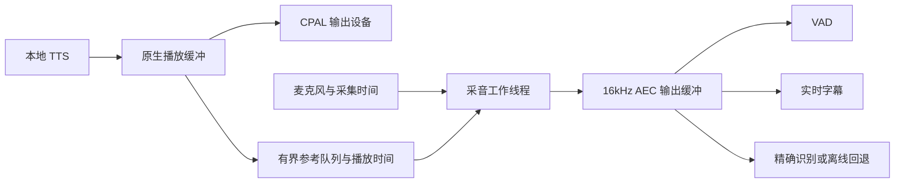

# 播放参考信号与采音端 AEC

本阶段把现有 Sonora AEC3 接入生产音频模块。默认关闭；当前录音仍会先停止播放，因此这一步不等于播报期间监听或语音打断。自然麦克风、扬声器双讲和声学效果仍需现场验证。

## 数据路径



`render_reference.rs` 从最终设备格式的回调缓冲提取单声道参考，包含预缓冲、欠载、取消及播放缓冲锁竞争时实际提交的零值。参考通过预分配的有界通道写入，正常回调不争用消费者状态锁；只有队列满时才尝试移除最早块，仍不能等待。缺口单独计数，不伪装成静音。原生参考在工作线程拼成 10ms 帧，由 Sonora 使用其原生采样率配置处理。标准库的固定缓冲及非阻塞发送约定见 [sync_channel](https://doc.rust-lang.org/std/sync/mpsc/index.html) 与 [try_send](https://doc.rust-lang.org/std/sync/mpsc/struct.SyncSender.html#method.try_send)。

`capture_processing.rs` 将原始采音按同一游标转为 16kHz。实时路径只在复制一帧时持有原始缓冲锁，随后释放锁再运行 AEC。VAD、流式 ASR 和最终 ASR 使用同一份输出；20 秒上限及关闭收据仍采用原始采样事实。关闭输入后才处理剩余音频，不足一帧的尾部保留并记为未处理，不补造录音静音。

CPAL 时间用于估计输出和采集时间，延迟按 `(t_render - t_analyze) + (t_process - t_capture)` 计算。未知时间、丢失参考、设备流改变或无效延迟会重置/旁路，保留输入内容。SAPI 没有原生 PCM 参考，明确保持不可用。停止后的参考保留约 300ms；流已结束且越过最后预测播放时间时，继续送入已知零参考，避免 AEC 的 reverse stream 停滞。这个时长及时间估计均不是声学测量结论。

## 显式启用

仅在准备测试的独立 root 中创建 `runtime/audio-processing-policy.json`，重启后生效：

```json
{"protocol_version":1,"mode":"render_reference_aec_v1"}
```

缺失或 `mode:"off"` 保持原路径；无效文件显示配置错误并保持关闭。当前正常安装和对话 Demo 没有创建此文件。状态只包含计数及原因，不包含原始 PCM；查看音频状态中的 `capture_processing`、`render_reference`。独立语音桥的 `status.data.audio_processing` 也只返回这些诊断计数，桥接接收的外部 WAV 不因此自动经过采音 AEC。

## 验证范围

定向检查覆盖原生格式/零参考、缺口、停止后的尾部连续性、采音时间、同一处理缓冲进入 VAD/ASR、最终不足帧尾部和原始缓冲擦除。完整库 **625 通过、0 失败、20 忽略**；独立离线探针单元测试 **15 通过、0 失败、2 忽略**。主程序和独立语音桥 release 构建通过，默认关闭配置下的桥接协议与真实主程序 HTTP 检查通过。构建保留旧离线兼容接口、预留播放代次字段及 LegacyV1 的 unused 警告，未声称零警告。

在真实 48kHz 双声道输出设备上播放固定的 2.645 秒合成 WAV，直接检查生产 `PcmOutput` 回调。首版 Mutex 队列丢失 480 个参考样本，原报告为 FAIL；改为有界通道后，原条件复测收到 127776 个参考样本（267 块），其中 76463 个非零值，丢样、时间未知、间断、播放欠载均为 0，设备正常关闭。首版与修复版报告分别为 [native-output-first.json](../runtime/goal-baselines/20261109/aec-runtime-next/native-output-first.json) 和 [native-output-second.json](../runtime/goal-baselines/20261109/aec-runtime-next/native-output-second.json)。这是调试库测试中的实际输出回调检查，没有打开麦克风、调用推理模型或测量扬声器声学输出，也不证明长期零丢样。

既有 [离线 AEC 结果](AEC_OFFLINE_PROBE_20261104.md) 的双讲衰减与算法固有时延限制保留。这里验证了接线、数据保留和参考可用性，未认证真实房间中的回声抑制、手动松开处的语音质量或打断准确率。

下一步需要让同一个采音 owner 在回复播放期间显式监听，基于 AEC 后的近端起音精确取消当前回复，并保留起音前的短片段。此功能尚未启用；现有停止按钮、Esc 和按住说话仍是打断方式。
