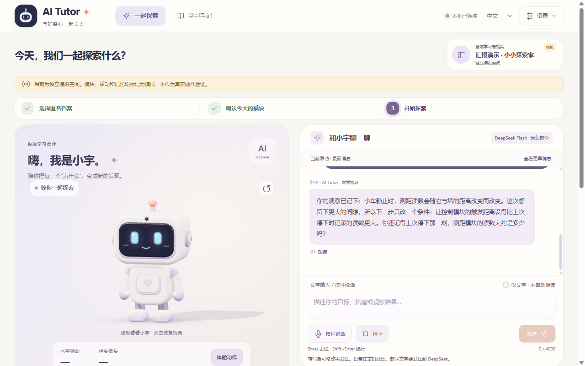
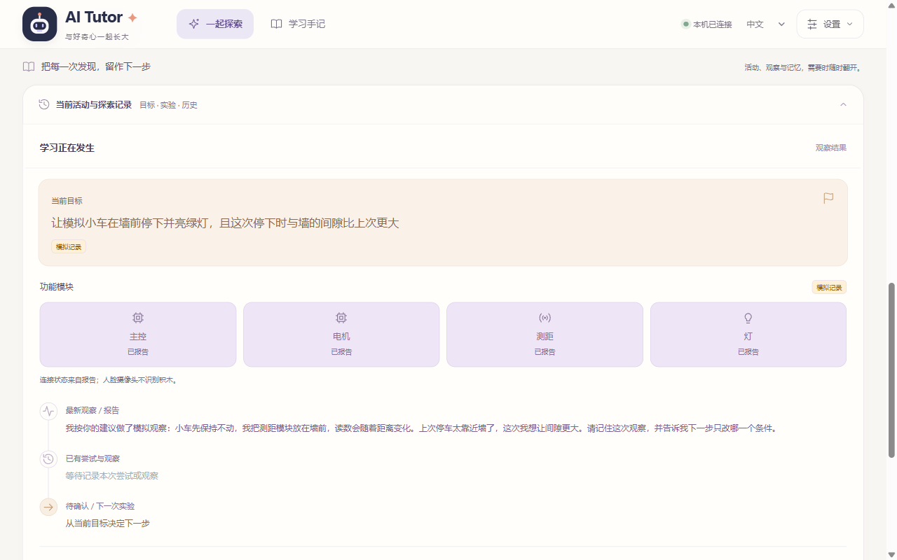
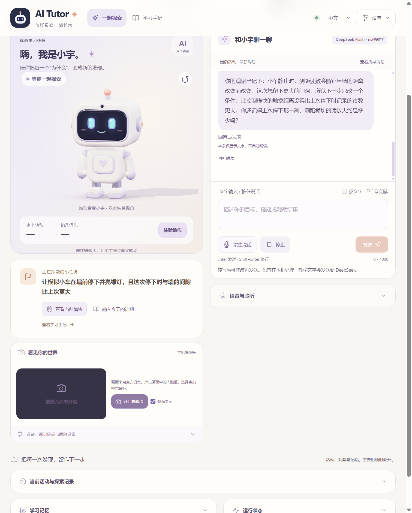
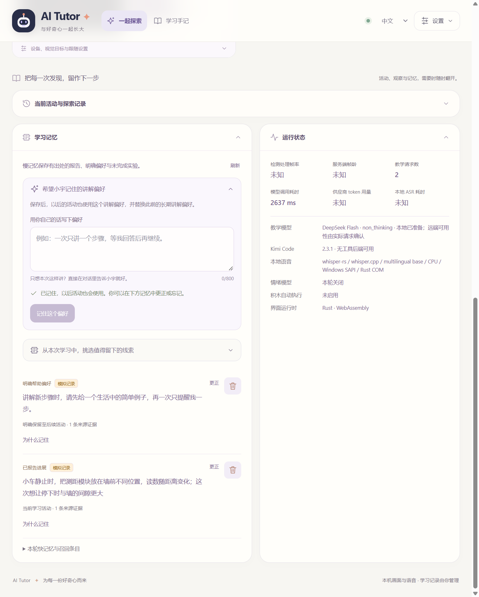

# AI Tutor 明日汇报与真实演示指南

> 目标：用 10 分钟完整展示「提出想法 → 确认模块 → 教学互动 → 模拟观察 → 本地播报 → 活动与记忆 → 视觉与隐私」。
>
> 核心原则：**现场能做就真实操作，网络或设备受限就展示已经取得的真实证据；不把模拟说成实体，不把人脸检测说成身份或情绪识别。**

## 一、汇报主线与开场

### 一句话定位

**AI Tutor 是一个本机优先的建造学习伙伴：它不替学习者直接完成作品，而是陪伴大家把目标说清楚、做一次小实验、记录观察，再决定下一步。**

### 30 秒开场参考

> 「很多时候，AI 工具习惯直接给答案。但学习真正发生的时刻，往往是孩子说出想法、动手试验、发现结果和预想不一样的那一刻。AI Tutor 希望留住这个过程。今天我会用一次模拟小车探索，展示它怎样提问、引导、记住进步，以及怎样保护学习者的数据和选择权。」

首屏使用：



---

## 二、汇报前 30 分钟准备清单

### 1. 程序与网络

- [ ] 在项目根目录完成 `scripts/install-rust.ps1`，确保 Rust 服务与 WASM 界面均已安装。
- [ ] 确认 `runtime/teaching-provider-policy.json` 选择 `deepseek_flash`、`non_thinking`。
- [ ] DeepSeek 密钥只保存在 `%LOCALAPPDATA%/AI Tutor/secrets/deepseek.dpapi`，由 Windows 当前用户 DPAPI 加密；**不要放进项目、PPT 或截图**。
- [ ] 如需现场调用模型，先完成一次无工具 Flash 请求；不要等上台后才第一次测试网络。
- [ ] 双击 `Start AI Tutor.cmd`，确认页面显示「本机已连接」和「DeepSeek Flash · 远程教学」。
- [ ] 浏览器建议 1280×800 或更高，缩放 100%，关闭无关标签页和系统通知。

### 2. 演示档案

推荐使用已经验证过的匿名模拟档案：**`汇报演示 · 小小探索家`**。

- [ ] 明确显示「独立模拟空间」，不要使用真实学习者档案。
- [ ] 模块来源为模拟：主控、电机、测距、灯。
- [ ] 若要做全新的现场两轮对话，先「开始新的探索」，再重新确认这四个模拟模块；历史目标不能自动当作今天的搭建。
- [ ] 若只做回放，直接使用本文截图和下方真实回复，不要假装正在调用模型。

### 3. 语音与视觉

- [ ] 现场朗读前检查系统音量；点击「朗读」后应能正常停止。
- [ ] 自然麦克风、回声和课堂打断未在本轮重新验收，不作为必演项目。
- [ ] 摄像头非必需。没有真实设备时，使用本文的互联网照片检测结果，明确这是**离线人脸检测**。
- [ ] 物理云台保持关闭，不在汇报现场尝试运动或急停。

### 4. 备用材料

- [ ] 提前打开本指南和 `docs/assets/` 中的截图。
- [ ] 准备 PDF 或幻灯片，至少包含首屏、真实对话、活动记录、记忆与状态、人脸检测五张图。
- [ ] 将本文两轮输入与真实回复放在演讲者备注中，网络故障时标为「此前真实交互回放」。

---

## 三、10 分钟完整演示流程

### 0:00–0:45｜产品定位：不是答案机，而是学习伙伴

**操作**：展示首屏和机器人。

**讲解重点**：

- 目标是帮助学习者经历「提问、搭建、试验、观察、修改」。
- 小宇是界面里的学习伙伴；拖动和「体验动作」只改变屏幕模型，不等于移动真实摄像头。
- 支持中文/英文界面、桌面和手机布局。

**过渡语**：

> 「接下来我不先讲技术，而是完整做一次学习活动。」

### 0:45–1:30｜三步准备：匿名档案、模拟空间、模块来源

**操作**：

1. 指向「选择匿名档案 → 确认今天的模块 → 开始探索」动态引导。
2. 打开「设置」，展示档案名称和独立模拟空间。
3. 展示主控、电机、测距、灯及模拟来源，关闭设置。

**讲解重点**：

- 真实档案与模拟档案使用独立数据库。
- 模块来自学习者报告、教师确认或模拟，不由摄像头猜出来。
- 新活动可以召回历史，但今天的搭建必须重新确认。



### 1:30–3:00｜第一轮真实 Flash：从目标到最简单的一步

**现场输入**：

```text
我想让模拟小车在墙前停下来，然后亮绿灯。现在有主控、电机、测距和灯。请先给我一个最简单的实验步骤，不要直接替我完成。
```

**本次已验证的真实回复**：

> 先做最简单的一步：只把测距模块读数想清楚，让小车静止不动，你把它举在墙前不同距离处，看读数怎样变化。观察后告诉我：你能找到一个大约对应“该停下”的距离读数吗？

**讲解重点**：

- 模型没有替学习者完成搭建，而是给出可执行的最小下一步。
- 页面显示真实请求状态；回复只有显示后才进入已投递上下文。
- 本轮教学文字发送到 DeepSeek，模型没有 shell、文件或设备工具。

### 3:00–4:30｜第二轮真实 Flash：观察、比较和单变量修改

**现场输入**：

```text
我按你的建议做了模拟观察：小车先保持不动，我把测距模块放在墙前，读数会随着距离变化。上次停车太靠近墙了，这次我想让间隙更大。请记住这次观察，并告诉我下一步只改哪一个条件。
```

**本次已验证的真实回复**：

> 你的观察已记下：小车静止时，测距读数会随它与墙的距离改变而改变。这次想留下更大的间隙，所以下一步只改一个条件：让控制模块的触发距离设得比上次停下时记录的读数更大。你还记得上次停下那一刻，测距模块的读数大约是多少吗？

**讲解重点**：

- 把学习者的新观察带入下一轮，而不是每次重新开始。
- 强调「只改一个条件」，培养比较和实验意识。
- 观察仍是模拟报告，不会被升级成真实传感器数据或实体小车运行证据。



### 4:30–5:15｜本地语音：可以听，也随时可以停

**操作**：

1. 点击当前有效回复下的「朗读」。
2. 让 Windows SAPI 朗读一小段。
3. 点击「停止」，或按 Esc。

**本次验证**：页面实际触发后，服务音频状态进入 `speaking`，随后通过本机 CLI 正常停止。

**讲解重点**：

- 识别与播报在本机完成；原始录音默认不保存。
- 按住说话后先转写，教师可以检查和编辑，再主动发送。
- 连续语音轮换和说话打断属于实验功能，不在本次汇报中宣称课堂验收通过。

### 5:15–6:30｜学习记忆：有来源、可纠正、可遗忘

**操作**：

1. 打开「学习记忆」。
2. 展开「希望小宇记住的讲解偏好」。
3. 输入并保存：

```text
讲解新步骤时，请先给一个生活中的简单例子，再一次只提醒我一步。
```

4. 指向记忆类型、模拟来源、来源证据、「为什么记住」、「更正」和删除入口。

**本次实际形成的两条记忆**：

- 学习进展：小车静止时，测距读数随距离变化；希望停车间隙更大。
- 明确偏好：先给生活例子，再一次只提醒一步。

**讲解重点**：

- 快记忆负责当前活动，慢记忆保留有来源的进展和明确偏好。
- 遗忘不仅是隐藏一行文字，还会处理相关来源、派生记忆与暂态上下文。
- 可以展示更正，但不要在正式演示前误删准备好的记忆。



### 6:30–7:15｜活动记录：把过程留下来，而不是只留最后答案

**操作**：打开「当前活动与探索记录」，依次指向当前目标、四种模块、最新观察和待确认步骤。

**可选补充**：展开「比较两种做法」，说明 A/B 记录支持未知次数、未测条件和待测计划；保存草稿不等于实验已经完成。

**讲解重点**：

- 保存的是学习过程和证据，不只是一段聊天。
- 建议、计划和实际完成是不同状态。
- 跨活动续做时，旧计划需要重新核对，不能自动当成今天已执行。

### 7:15–8:15｜视觉演示：检测人脸，但不识别你是谁

展示下面这张**真实模型推理后的标注图**：


**本次证据**：

- 照片：[Michael Dam / Unsplash](https://unsplash.com/photos/mEZ3PoFGs_k)，Unsplash License。
- 项目固定 ONNX 模型在本地完成推理，检测到 1 张人脸。
- 置信度约 **0.906**；标注框来自真实模型输出，不是手工画上的演示框。
- 原图不发送给远程教学服务。

**必须同时说明**：

- 这是**人脸检测**，不是身份识别。
- 即使照片人物在微笑，也**不据此生成快乐、专注、理解力或任何情绪评分**。
- 当前「情绪模型：关闭 · 不根据人脸推断情绪」。
- 摄像头只用于画面内临时目标选择，选择人脸不会切换学习者档案，也不会自动启用云台。

### 8:15–9:00｜手机与 GUI 易用性

展示 390px 真实页面：


**本轮优化**：

- 小高度桌面窗口优先显示输入、语音、停止和发送按钮。
- 新增动态三步准备引导，用户始终知道下一步。
- 增加 Enter / Shift+Enter 提示和 4000 字计数。
- 提高辅助文字可读性，保留清晰键盘焦点。
- 手机端先显示对话，再显示机器人和辅助面板。

### 9:00–10:00｜架构、隐私和诚实边界

**讲解重点**：

- Rust / Tokio / Axum 承载本机服务，Rust / Yew 编译 WebAssembly 界面。
- 教学文本走当前选择的远程模型；摄像头、录音、本地识别和播报留在本机。
- 服务只监听 `127.0.0.1`，页面、视频和 WebSocket 都有认证与来源检查。
- 不把历史测试数量当成所有场景通过，不把演示机器人当成实体硬件。

**收尾参考**：

> 「AI Tutor 最想保留的不是一次漂亮回答，而是学习者怎样从一个想法走到一次尝试，再走到下一次尝试。它记得进步，也允许纠正和遗忘；它使用 AI，但把动手的主动权和学习数据的选择权留给人。」

---

## 四、5 分钟压缩版

| 时间 | 内容 | 使用素材或操作 |
|---|---|---|
| 0:00–0:30 | 定位与三步引导 | 首屏 |
| 0:30–1:45 | 两轮教学对话 | 现场调用；网络异常时用真实回复回放 |
| 1:45–2:30 | 活动与两条记忆 | 活动图、记忆图 |
| 2:30–3:15 | 本地朗读与停止 | 现场朗读；设备异常时说明既有状态证据 |
| 3:15–4:15 | 人脸检测、情绪边界与隐私 | 标注照片与运行状态 |
| 4:15–5:00 | 手机、架构与总结 | 手机图、首屏 |

压缩版不展开实验比较、历史分页、语音服务详情和云台高级设置。

---

## 五、故障与备用方案

### A. DeepSeek 或网络不可用

- 停止反复点击发送，避免重复请求。
- 明确说：「下面是刚才同一版本、同一模拟档案取得的两次真实 Flash 回复回放。」
- 使用 `gui-conversation.png`，继续讲活动、记忆和隐私；这些功能不依赖现场再次调用。

### B. 没有摄像头或设备初始化失败

- 不展示空白错误页面浪费时间。
- 使用 `face-detection-unsplash.jpg`，说明这是固定模型对互联网照片的离线推理结果。
- 不宣称实时摄像头、多人遮挡、拔插或云台已经通过。

### C. 麦克风或声音不可用

- 使用文字完成两轮交互。
- 展示「按住说话」和「朗读」入口，说明本轮只验证了实际播报状态与停止，不把现场失声包装成通过。

### D. 演示档案被修改或记忆被删除

- 不恢复其他真实学习者的数据。
- 新建一个匿名模拟档案，重新确认四个模拟模块。
- 若无法恢复记忆演示，直接使用已保存的真实记忆截图，并标为此前验证结果。

### E. 只剩 2 分钟

展示三张图：`gui-overview.png` → `gui-memory-diagnostics.png` → `face-detection-unsplash.jpg`。只讲「学习闭环、可管理记忆、本机隐私与能力边界」。

---

## 六、汇报时可以说与不可以说

| 主题 | 可以说 | 不要说 |
|---|---|---|
| 教学 | 两次真实 DeepSeek Flash 请求均成功，页面显示完整回复 | 模型在所有题目和语言上质量都已通过 |
| 模拟小车 | 使用模拟模块、观察和独立数据库演示学习闭环 | 已经控制真实小车完成避障 |
| 人脸 | 本地 ONNX 对互联网照片检测到 1 张人脸 | 识别出了照片人物是谁 |
| 情绪 | 当前关闭，不从人脸推断情绪 | 从微笑判断快乐、专注或理解力 |
| 语音 | 页面实际触发 Windows SAPI 播报并正常停止 | 本轮已通过自然麦克风、回声和课堂打断全项验收 |
| 记忆 | 两条有模拟来源的记忆可查看、纠正和遗忘 | AI 会自动记住所有对话且永远正确 |
| 机器人 | 3D 视角与动作是界面演示 | 体验动作证明实体云台已运动 |
| 测试 | 本轮 UI 179 项通过，WASM 构建成功，实际浏览器完成交互 | 全部硬件和全部服务测试均通过 |

---

## 七、建议幻灯片结构（6–8 页）

1. **封面**：产品标语 + `gui-overview.png`。
2. **学习闭环**：目标 → 模块 → 试验 → 观察 → 修改 → 保存。
3. **真实教学互动**：两轮输入与回复 + `gui-conversation.png`。
4. **学习过程与记忆**：`gui-activity.png`、`gui-memory-diagnostics.png`。
5. **语音与视觉**：朗读/停止流程 + 人脸标注图。
6. **本机隐私与架构**：数据去向表、Rust/WASM 简图。
7. **桌面与手机体验**：`gui-mobile.png`。
8. **边界与下一步**：自然语音、多人视觉、真实设备与云台仍需现场验收。

---

## 八、本次验证记录

- GUI：`cargo test --locked -p tutor-ui --target-dir target/ui`，**179 通过、0 失败**。
- WASM：`frontend/build.ps1` 发布构建成功。
- 实际浏览器：创建/选择匿名模拟档案、确认四个模拟模块、完成两轮 DeepSeek Flash 对话、保存两条记忆、触发并停止本地播报。
- Flash：两次请求均返回 HTTP 200；第二次总耗时约 2.63 秒，流式标记完整，模型为 `deepseek-flash`。
- 人脸：显式离线探针 `annotated_internet_photo_face_detection_probe` 通过，1 张人脸，置信度约 0.906。
- 全量服务库：696 通过、24 忽略；另有 2 个 Kimi 扩展隔离测试失败，位于本次未修改的工作区文件。它们不计为本次 GUI 验收通过项，也不在本次任务中顺带修复。
- 截图不包含 DeepSeek 密钥、启动认证令牌或真实学习者对话。

## 九、素材索引

| 文件 | 用途 |
|---|---|
| `assets/gui-overview.png` | 优化后的首屏与三步引导 |
| `assets/gui-conversation.png` | 真实教学对话与输入区 |
| `assets/gui-activity.png` | 当前目标、模拟模块和观察 |
| `assets/gui-memory-preference.png` | 明确讲解偏好的保存过程 |
| `assets/gui-memory-diagnostics.png` | 两条记忆、真实指标和情绪关闭状态 |
| `assets/gui-mobile.png` | 390px 手机真实页面 |
| `assets/face-detection-unsplash.jpg` | 互联网照片的真实离线人脸检测 |
